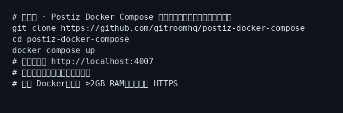
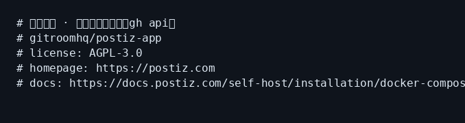

# Postiz 小白中文教程

> 开源自托管社媒排期平台入门指南（社区非官方教程）  
> 上游：[`gitroomhq/postiz-app`](https://github.com/gitroomhq/postiz-app) · 官网：[postiz.com](https://postiz.com)  
> 教程校对日期：2026-10-28（Asia/Shanghai）· 安装以官方 Docker Compose 为准

[](https://github.com/xianyu110/awesome-postiz-zh)
[](https://github.com/gitroomhq/postiz-app)
[](LICENSE)
[](https://xianyu110.github.io/awesome-postiz-zh/)

---

## 截图索引

| # | 文件 | 类型 | 说明 |
|---|------|------|------|
| 1 | [`images/01-compose-schematic.png`](images/01-compose-schematic.png) | **示意图** | 官方 Docker Compose 安装流程（本机未拉起全栈） |
| 2 | [`images/02-ui-schematic.png`](images/02-ui-schematic.png) | **示意图** | 默认 `http://localhost:4007` 界面示意 |
| 3 | [`images/03-meta-real.png`](images/03-meta-real.png) | **真实** | 上游仓库元数据（许可证 / 主页 / stars） |

> 本教程环境**未**在本机用 Docker 拉起 Postiz 全栈；Compose 步骤与端口均摘自官方文档，未编造菜单。

---

## 这是什么？

**Postiz** 是开源的社交媒体排期 / 协作平台：

- 多平台发帖排期、日历、分析、团队协作
- 可用 **Postiz Cloud**（托管）或 **Open-source 自托管**（自己的服务器）
- 官方推荐用 [`gitroomhq/postiz-docker-compose`](https://github.com/gitroomhq/postiz-docker-compose) 一键部署
- 自托管默认前端约 **`http://localhost:4007`**（容器内 `5000` 映射到宿主 `4007`）；Temporal UI 约 `http://localhost:8080`

本仓库只提供**中文小白教程**（MIT），**不包含**上游软件本体，也不二次分发官方镜像。

---

## 官方链接（请以官方为准）

| 资源 | 链接 |
|------|------|
| 官网 / Cloud | https://postiz.com |
| 文档 | https://docs.postiz.com |
| 源码 | https://github.com/gitroomhq/postiz-app |
| Docker Compose（推荐） | https://github.com/gitroomhq/postiz-docker-compose |
| 快速开始 | https://docs.postiz.com/quickstart |
| Compose 安装 | https://docs.postiz.com/self-host/installation/docker-compose |
| 自托管排错 | https://docs.postiz.com/self-host/troubleshooting |
| 配置参考 | https://docs.postiz.com/self-host/configuration/reference |
| 从旧版迁移（Temporal） | https://docs.postiz.com/installation/migration |

---

## Cloud vs Open-source（摘要，以官方 README 为准）

官方明确：**不「阉割」核心功能**；主要差别在基础设施、社媒开发者应用审批、运维责任。

| 方面 | Postiz Cloud | Open-source 自托管 |
|------|--------------|-------------------|
| 费用 | 订阅（常有试用） | AGPL-3.0 免费；自付机器与 API |
| 社媒应用 | 官方已审批好的应用 | **需自备**各平台 Developer App（Meta / YouTube / TikTok 等可能要数周） |
| AI | 云端配额；密钥由 Postiz 管 | **自带** OpenAI 等兼容 Key；无配额上限，按供应商计费 |
| 数据 | 在 Postiz 基础设施 | 留在你自己的环境 |

细节与表格以 [上游 README](https://github.com/gitroomhq/postiz-app)「Postiz Cloud vs. Open-source」为准。

---

## 环境要求（摘要）

- 已安装 **Docker** + **Docker Compose**
- 官方 Compose 文档称曾在 **Ubuntu 24.04、2 GB RAM、2 vCPU** 虚拟机测过；资源紧张时易 OOM
- 自托管需配置 Postgres、Redis、存储与大量环境变量（见配置参考）

---

## 安装：官方 Docker Compose（推荐）

> 始终从官方仓库拉取 Compose，不要抄旧快照——服务、镜像、环境变量会变。

```bash
git clone https://github.com/gitroomhq/postiz-docker-compose
cd postiz-docker-compose
# 按官方文档配置环境变量（docker-compose.yml / postiz.env / .env）
docker compose up
```

等待启动后：

1. 前端：`http://localhost:4007`（除非你改了端口映射）
2. Temporal UI：`http://localhost:8080`




上游仓库元数据（本教程采集时）：



修改环境变量后需 `docker compose down` 再 `docker compose up` 才会重建容器（官方警告）。

---

## 第一次演示任务（约 15 分钟）

与官方 [Schedule your first post](https://docs.postiz.com/quickstart) 对齐：

1. 进入 Postiz（Cloud 注册，或自托管打开实例并注册；首个账号为组织所有者）。
2. **Add Channel** 连接一个渠道。自托管最快可试：Bluesky / Lemmy / Nostr / Medium / Dev.to / Hashnode / WordPress / Listmonk（官方称这 8 个可在对话框里自填凭据，无需先配环境变量里的 Provider Key）。
3. **Create Post**，在 Global 写一次内容，按需解锁单渠道定制。
4. 选时间 → **Add to calendar** 或 **Post Now**。
5. 回到日历确认状态；失败时看卡片红圈与 tooltip。

自托管连接 X / Meta / YouTube 等前，务必按 [Provider API keys](https://docs.postiz.com) 注册自己的开发者应用。

---

## 常见报错与处理

| 现象 | 可能原因 | 处理 |
|------|----------|------|
| 内存不足 / 容器被杀 | RAM 过小；`pnpm install` 堆溢出 | 加内存；源码装可用 `NODE_OPTIONS=--max-old-space-size=4096`；2 GB 机器建议用预构建镜像而非本机构建 |
| Temporal 不可达 / 排期不跑 | v2.12.0+ 依赖 Temporal；`TEMPORAL_ADDRESS` 不对 | 查 Compose 日志；升级按[迁移指南](https://docs.postiz.com/installation/migration) |
| 端口占用 | `4007` / `8080` / `7233` 被占用 | 改映射或释放端口；容器内仍是 `5000` |
| HTTPS / Cookie / Invalid state | `FRONTEND_URL` 与 `NEXT_PUBLIC_BACKEND_URL` 不同父域；协议端口不一致 | 同一主机名反代；URL 含协议与端口完全一致 |
| Origin not allowed | CORS 白名单来自 `FRONTEND_URL`（+ `MAIN_URL`） | 浏览器访问 URL 必须与配置一致 |
| 重启后全员登出 | `JWT_SECRET` 被重新生成 | 首次部署固定密钥，勿轻改 |
| `postgres ECONNREFUSED` | `DATABASE_URL` 写成容器内 `localhost` | 用 Compose 服务名 `postgres` |
| 登录后 API 404 | 后端 URL / Cookie 域不匹配 | 核对 `NEXT_PUBLIC_BACKEND_URL` |

更多见官方 [Self-Host Gotchas](https://docs.postiz.com/self-host/troubleshooting)。

---

## 模型 / API 合规说明（国内读者）

- 自托管 AI 功能需**自带** OpenAI 兼容等 Key，或先跳过 AI 功能。
- 本教程**不硬推**未备案境外模型中转。若需聚合兼容接口，可自行评估 [TryAllAPI](https://tryallapi.com/register?aff=5A6A)（轻提示，`aff=5A6A`，非必须）。
- 相关工具选购（可选）：[https://wzyp.cn/shop/maynorai](https://wzyp.cn/shop/maynorai)。
- **绝不**使用或推荐 `momoai.dadoudou117.com` 等未备案中转域名。

---

## 许可证说明

| 内容 | 协议 |
|------|------|
| **本教程文案**（本仓库 README / docs） | [MIT](LICENSE) |
| **Postiz 上游软件** | [AGPL-3.0](https://github.com/gitroomhq/postiz-app/blob/main/LICENSE) |

自托管若修改并对外提供网络服务，请自行遵守 AGPL-3.0 义务（含源码提供等）。本仓库与 Postiz / gitroomhq **无官方隶属关系**。

---

## 维护

- 作者：Maynor（[@xianyu110](https://github.com/xianyu110) / Maynor996）
- 上游问题：https://github.com/gitroomhq/postiz-app/issues
- 在线页：https://xianyu110.github.io/awesome-postiz-zh/
